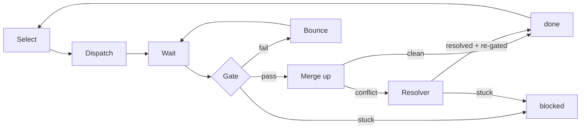

Run the task graph (`/yaco-task`): dispatch each runnable leaf to an `/implement` worker
(`/yaco-agent`) in its own worktree, **gate** its output by reading evidence — never by redoing
the work — and merge it up the worktree/branch DAG, which mirrors the task DAG
(`/yaco-worktree`). Every `yaco` call passes `--json`.



## Select

In the active workset (`yaco task list --json`), a task is runnable when all hold:

- it is `ready` and a **leaf** (no task names it as `parent`)
- every `depends` is terminal (done/cancelled) **and already in the leaf's merge target**. A
  predecessor merged elsewhere — a `depends` crossing a milestone boundary — is an authoring
  error: skip and flag (fix: co-locate the leaves under one integration milestone, or depend on
  the whole milestone)
- its `resources`, if any, are free — check ports/processes, what running and already-picked
  tasks hold, and processes outside the project (e.g. `lsof -i :9222`)
- its slug (the `worktree` field, else the task id) is unique among runnable leaves — a
  duplicate is an authoring error

Dispatch **every** runnable leaf in parallel: worktrees isolate them, so overlapping `scope` is
settled at merge, and ordering comes only from `depends`. When agent slots or resources are
scarce, take higher priority first (`critical > high > normal > low`), then disjoint scopes,
then fewer depends → smaller estimate → alphabetical.

## Dispatch

```bash
primary="$(git rev-parse --show-toplevel)"   # orchestrate runs in the primary checkout
# Target = the nearest integration-milestone ancestor's branch, else main.
yaco worktree create <milestone-slug> --base <parent-target> --json   # only when the target is a milestone
target="task/<milestone-slug>"                                        # else: target="main"
cwd="$(yaco worktree create <slug> --base "$target" --json | jq -r .data.path)"
base="$(git -C "$cwd" rev-parse HEAD)"       # before the worker commits: the task's work is $base..HEAD
yaco task set <task-id> --data '{"state":"running"}' --repo "$primary" --json
cd "$cwd" && yaco agent start claude "/implement <task-ref> — <task-context>" --name "w-<task-id>" --json
yaco task attach <task-id> w-<task-id> --repo "$primary" --json
yaco agent wait w-<task-id> --from-start --json
```

- **The prompt** carries the task's title, acceptCriteria, design-doc path, scope, stated intent (demo, spike), and the worker contract: **finish the recipe, stop, report — never mark the task `done`**. A leaf with no code recipe (docs, design, planning) gets its task prompt directly, without `/implement`.
- **The live task graph is the primary's**, whatever the cwd — hence `--repo "$primary"` on every `yaco task` call. Where the plan is tracked in the host repo (`/yaco-paths` → Plan privacy), commit each graph change before merging (`git -C "$primary" commit -m "chore(plan): <task-id> state" -- .yaco/plan`): `yaco worktree merge` refuses a dirty primary.
- **`wait` returns at the worker's first idle.** With background tasks or sub-agents the worker may resume on its own, so the return is a cue to gate, not proof of done.

## Gate

A leaf passes when all three hold — checked by you in its cwd, never taken on the worker's word:

1. **The gate is green** — `yaco gate --base "$base" --json`: no `data.checks` entry (`verify · doc · review · qa`) is `fail`, and `data.dirty` is false.
2. **Every acceptCriteria item checks out** — file → `test -f`; command → run it, check the exit; observable → read the files or `git diff $base..HEAD`.
3. **A counted review is independent** — if `review` passed, its artifact header (`/yaco-paths` bundle home) names a reviewer other than the worker and covers this diff. The gate checks only that it exists and is fresh.

Then:

- **Pass** → merge up. With `requireHumanReview: true`, set `blocked` / `blockReason: "human-review"` and wait instead.
- **Fail** → bounce: `yaco agent send w-<task-id> "<what is missing or failing> — finish it" --wait --json`, then gate again. The worker finishes its own recipe; you don't drive fixes.
- **Stuck** — ~3 bounces without progress, or a decision only a human can make → `blocked` / `blockReason: "verification-failed"`, noting the check. Move on to other tasks.

## Merge up

`done` means gated **and merged**. `/yaco-worktree` owns the mechanics (target rule, merge command, resolver protocol, per-target serialization):

1. Merge `task/<leaf>` into its target. Clean → `done`, then clean up the worktree.
2. Conflict → a resolver in the target checkout, then the resolver gate. Green → `done`; ~3 rounds without converging → the **triggering leaf** (not the milestone) `blocked` / `blockReason: "merge-conflict"`.
3. A milestone whose children are all terminal: run its `acceptCriteria` in its integration worktree, then merge it up the same way.

## Continue

After each batch, select again, keeping every session in play — yours included — within its context budget (`/yaco-agent` → Context). Stop only when:

- a `requireHumanReview` leaf is waiting — report it; the human **approves** (→ merge up → `done`), **requests changes** (→ `ready` + note), or **abandons** (→ `cancelled`)
- three tasks in a row failed — report all failures
- nothing is runnable — report final status, listing `blocked` tasks with their `note` / `blockReason` (never unblock them yourself); if a milestone landed, write its `/impl-summary` into the bundle home
